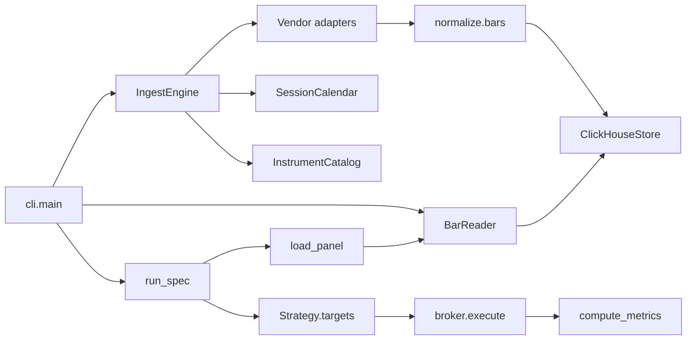

# Architecture

Local library and CLI. There is no HTTP API or job scheduler. One process reads `.env`, opens self-hosted ClickHouse (`ClickHouseStore`), and either fetches holes or runs a YAML Spec against bars already stored.

Two pipelines share the store. Ingest writes. The strategy engine only reads.

## Responsibilities

| Piece | Owns | Does not own |
| --- | --- | --- |
| `cli.py` | Argparse, exit codes, opening and closing the store | Vendor HTTP, fill math |
| `settings.py` | The five environment variables | Per-run knobs (those are the Spec) |
| `domain.py` | `Instrument`, `Bar`, `VendorBar`, `IngestRequest`, and the empty Bar frame | Persistence |
| `catalog/` | Stable ids and aliases | Which pool DexScreener picks |
| `adapters/` | One vendor protocol each | Timestamps, Coverage, Parquet paths |
| `ingest/engine.py` | Hole math, source routing, writes | Resampling |
| `normalize/bars.py` | Vendor time → UTC, OHLC checks, Yahoo decimal-island repair | Fills |
| `calendar/` | Venue sessions vs display IANA zones | Stored timezone columns |
| `store/` | ClickHouse bars + catalog + snapshots | Strategy weights |
| `query/reader.py` | Scans, `ts_local`, derived resample | Fetching |
| `strategy/spec.py` | YAML contract | Execution |
| `strategy/panel.py` | Coverage check, decision clock, FX, cash yield | Targets |
| `strategy/plugins/` | Causal targets | Fills, fees, Sharpe |
| `strategy/broker.py` | Next-open fills, band, drift, fees, cash | Indicator math |
| `strategy/engine.py` | Run loop, metrics, stdout table | Fetching |
| `ta/` | Causal indicator columns | Weights |
| `inspect/` | Unexpected-gap flags and Plotly HTML | The store |

## Seams that stay

These are recorded in ADRs. One implementation is enough.

- **`BarStore`** ([ADR-0002](adr/0002-parquet-duckdb.md)). Ingest, `BarReader`, and the strategy engine depend on the interface. `ClickHouseStore` is the adapter. The CLI constructs it directly.
- **`Strategy` + registry** ([ADR-0005](adr/0005-strategy-plugins.md)). The engine looks up a name. It does not import `sma_cross` to run it. Built-ins register on import of `strategy.plugins`. Extra plugins load from `spec.plugins` via `importlib`.
- **`backtester.ta`** ([ADR-0006](adr/0006-ta-module.md)). Public functions, grouped by `instrument_id`. Not a second registry.

`SourceAdapter` is the vendor seam because there are several real adapters (Yahoo, Alpha Vantage, CCXT, DexScreener, GeckoTerminal).

## Clocks

Three clocks, never mixed ([ADR-0001](adr/0001-utc-storage-display-tz.md)):

1. **Storage.** Timezone-aware UTC. `ts_utc` is bar open. Hive `year=` / `month=` follow that UTC timestamp.
2. **Session.** Venue calendar used to decide which missing bars are expected gaps. US equity uses `America/New_York`. NSE uses `Asia/Kolkata`. Crypto and DEX are 24/7 UTC.
3. **Display.** IANA name on `BarReader.read(tz=...)` and CLI `--tz`. Adds `ts_local`. Abbreviations (`IST`, `EDT`) and fixed offsets fail. Never guessed from the machine when `BACKTESTER_TZ` is unset.

Naive CLI datetimes are interpreted in the display zone (`cli._parse_dt`). Naive Spec dates are UTC (`spec._parse_bound`). Date-only end bounds are exclusive: start of the next day. Those two parsers look similar and are not the same rule.

## Signal vs fill

[ADR-0004](adr/0004-next-bar-open.md) and [ADR-0007](adr/0007-decision-clock-cash-band.md):

- A strategy may use the panel through this bar's close. It must not read bar `t+1`.
- The broker applies `weight.shift(1)` and trades at the next raw `open`, only when `|target − held|` clears the band.
- A target at `t` does not change the fill at open `t`. The last bar has a target and no fill.
- Weight `0` is a full exit, including when `half_move` is on. A null weight holds the last weight.
- `adj_close` is for signals. Fills stay on raw `open`. `total_return: true` scales OHLC by `adj_close / close` before the broker sees the panel.
- `cash_rate_id` is a yield series. Daily cash return is `close / 100 / 365`. Gross exposure still caps at 1. The rate id is not clustered and is not a universe member.
- Flat `rebalance_band` is the default. If `band_floor` or `band_frac` is set, the threshold is `max(band_floor, band_frac * |target|)`.
- `drift: false` holds the post-band weight constant until the next target. `drift: true` marks dollars through the gap and the open-to-close move, so the next entering weight has drifted with price. A Run may override the Spec.

Decision clocks (`native`, `nyse_1600`, `xnse`) change which timestamps exist on the panel. They do not change the fill rule. On `nyse_1600`, crypto is loaded as 1h and equities as 1d, then sampled onto the NYSE session grid. Weekend crypto does not create a decision row.

## Ingest invariants

- One request, one source. The engine does not fan out.
- Coverage is per `(instrument, timeframe, source)`. A completed range is not fetched again.
- Equity weekends and exchange holidays are expected gaps. Crypto weekends are bars.
- Yahoo and Alpha Vantage session-day holes collapse into one window. CCXT and GeckoTerminal stay paged.
- A truncated vendor records Coverage for the span written, not the hole requested.
- DexScreener writes `PairSnapshot` rows, never OHLC synthesized from `priceChange.h24`.
- Writes take an exclusive `flock` per Hive partition, stage a temp Parquet file, check the row count, then rename.

## Strategy invariants

- Missing Coverage raises `MissingCoverageError` with the `backtester ingest ...` command. The engine does not fetch.
- Unknown strategy names and unknown Spec keys fail at load.
- Compare and the metrics table score every Run from the latest ready timestamp on the Spec.
- SIP is $100 on the first decision day of each calendar month in that window. `sip_cagr` is the XIRR of those cashflows. It is not time-weighted CAGR. SIP max drawdown is on SIP wealth, separate from lump-sum max drawdown.
- `prism` cross-section math (vol, correlation, clusters, hysteresis, vol target) stays in the plugin. The broker does not know PRISM.

## What not to split

`prism.py`, `panel.py`, and `parquet_duckdb.py` are long because each is one workflow. Splitting the PRISM day loop, the three decision clocks, or the Parquet write from its DuckDB catalog row would scatter one operation across files. Add a docstring or a private function inside the module before adding a package.

## Errors and concurrency

`BacktesterError` and its subclasses are the user-facing failures. The CLI prints `error: ...` and exits 2. Other exceptions propagate.

During ingest, `IncompleteHistoryError` and `QuotaError` raised while filling a hole are caught inside `IngestEngine.ingest`, stored as warnings on the result, and Coverage is limited to the span actually written. `QuotaError` raised before that loop (no Alpha Vantage key) is not caught there, so the CLI exits 2. `PermanentVendorError` is not caught in the hole loop either. The CLI also has a local `IncompleteHistoryError` handler around `ingest()`; with the engine catching that type inside the hole loop, that handler does not run for a truncated Alpha Vantage page.

DuckDB access on one store takes an `RLock`. Partition file replacement takes an `flock`. Coverage merge is delete-every-row-for-that-triple, then insert the merged intervals, then commit. There is no unique constraint on `coverage`. Two processes writing the same catalog file are not a supported workflow beyond the partition lock.
