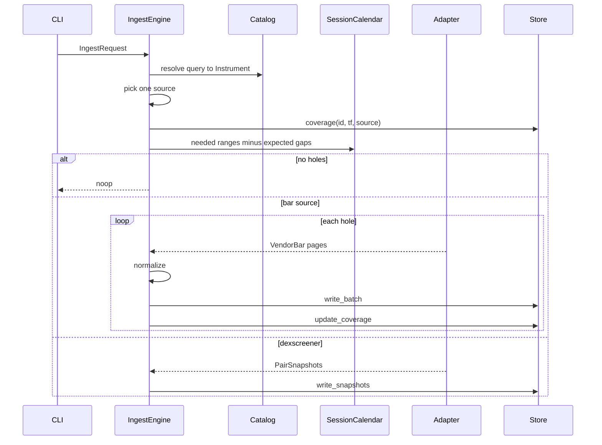
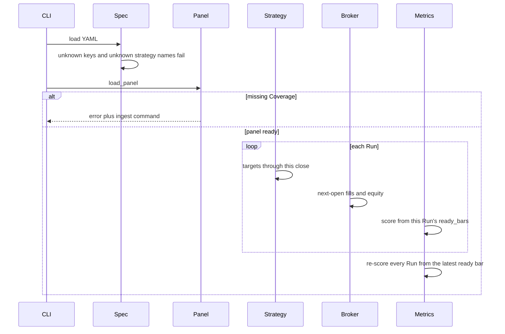

# CLI flows

`cli.main` parses argv, calls the subcommand handler, and turns `BacktesterError` into `error: ...` on stderr with exit code 2. Success is 0.

Every command that touches data loads `Settings`, checks `--tz` when the command has one, then opens `ClickHouseStore` through `_open_store`. Timezone checks happen first. The ClickHouse client closes when the command returns, including on failure after the store was opened.

`ta list`, `strat list`, and `serve` (API process) do not use the short-lived CLI store pattern the same way: `serve` holds one client for the process lifetime.

`ta list` and `strat list` do not open the store.

## ingest

1. `--from` / `--to` parse in `--tz` or `BACKTESTER_TZ` (default `UTC`). A date-only `--to` is the start of the next day. `Z` is accepted. `IST` and `EDT` fail.
2. The catalog resolves a ticker, `EQ:` / `CRYPTO:` / `DEX:` id, CCXT symbol, `chain:address`, or DexScreener URL. DEX queries that are not already stored with a `pair_created_at` go to DexScreener, then register.
3. Source: explicit `--source`, otherwise Alpha Vantage for equities when the key is set, else Yahoo. Crypto defaults to the venue (usually the CCXT id). DEX bars default to `geckoterminal`.
4. Coverage and expected session gaps are subtracted. Yahoo and Alpha Vantage collapse leftover session holes into one window.
5. Each page is normalized and written. A hole that was not truncated extends Coverage to the requested hole. A truncated adapter extends Coverage only from the earliest to latest written timestamp.
6. The same request again, once Coverage covers it, prints `noop=True` and writes nothing.
7. Stdout is one summary line: instrument id, source, timeframe, rows, holes, noop, and warnings. DEX alternatives print on a second line.

`PermanentVendorError` and a missing Alpha Vantage key exit 2. A truncated history or a quota hit mid-fetch returns exit 0 with `warnings=...`.

## read

`BarReader` scans ClickHouse `bars` for the UTC range. Output always has `ts_utc`. `--tz` adds `ts_local` and `utc_offset` minutes. `--resample` builds a derived series in that zone and does not write it. `--limit` only truncates the printed head (default 20). The `rows=` line is the full frame height.

## coverage

Prints inclusive UTC ranges for `(instrument, timeframe, source)`. Without `--source`, the command probes `yahoo`, `bhavcopy`, `alphavantage`, `binance`, `geckoterminal`, `dexscreener`, and `hyperliquid`. An empty catalog prints `no coverage`. `--tz` is accepted and not applied to the printed timestamps.

## compact

Merges small `part-*.parquet` files inside a partition (at least two parts, and either eight or more parts or an average part under about 1 MB). `--prune` drops 1m files for months older than `BACKTESTER_HOT_1M_DAYS` when Coverage already has a native `1h` or `1d` series for that source, and removes those months from Coverage. A later ingest of the pruned range fetches it again.

## chart

`--inventory` draws one lane per Coverage row. Otherwise the command needs a query and `--tf`. The default window is the Coverage span. `--no-open` writes HTML under `$TMPDIR` and prints the path. Red spans are unexpected gaps. Suspect quality, partial bars, non-positive volume, and range spikes are marked. A native series past about 20k bars may be drawn at a coarser timeframe; the title says so.

## ta list

Prints `backtester.ta.available()`: trend, momentum, volatility, volume, then structure. Indicators are not strategies.

## strat list

Prints registered names, sorted: `buy_hold`, `cap_mix`, `guard`, `periodic`, `prism`, `sma_cross`, `static`, `year_winner`.

## strat run and strat compare

1. `load_spec` rejects a missing file, a non-mapping document, and unknown keys.
2. `spec.plugins` entries are imported (`dotted.module` or a `.py` path) so `@register` runs.
3. One Panel is loaded for the whole Spec. `cash_rate_id` and `fx` are overlays, not extra universe names that get clustered. Cash yield is scaled by calendar days between panel stamps.
4. Each Run validates `params` with that strategy's pydantic model, emits targets, then `broker.execute`.
5. Metrics are recomputed so every Run's window starts at `max(ready_bars)`.
6. `strat run` prints the metrics table and stops.
7. `strat compare --chart` also writes `strat-compare-<spec name>.html` and opens it unless `--no-open`.

The table shows total return, CAGR, growth of $100, SIP ending value, SIP contributions, SIP multiple, SIP CAGR, SIP max drawdown, lump-sum max drawdown, trades, win rate, turnover, ending equity, and excess return versus the baseline Run. Sharpe, Sortino, and Calmar are on the `Metrics` object and are not columns in this table.

Exit 2 covers an unknown strategy, bad params, a missing file, and missing Coverage. The Coverage error includes the ingest command to run.
