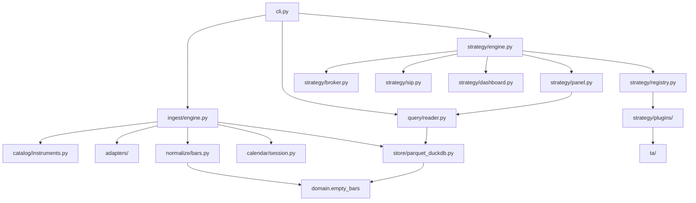

# Codebase map

Start at `src/backtester/cli.py` (`backtester` and `python -m backtester`). Domain words are in [CONTEXT.md](../CONTEXT.md). Decisions that should not be re-litigated are in [docs/adr/](adr/).

```
src/backtester/
  cli.py                 commands and store lifetime
  domain.py              Instrument, Bar, Request, empty Bar frame
  settings.py            env → Settings
  exceptions.py          BacktesterError hierarchy
  timeframes.py          1m 5m 15m 30m 1h 4h 1d
  adapters/              yahoo, alphavantage, ccxt, dexscreener, geckoterminal
  calendar/              session gaps and display timezones
  catalog/instruments.py stable ids, aliases, Yahoo ticker spelling
  ingest/engine.py       Coverage holes → fetch → write
  normalize/bars.py      VendorBar → stored columns
  store/                 BarStore and ParquetDuckDBStore
  query/reader.py        read, ts_local, resample
  inspect/               gap flags and series charts
  ta/                    causal indicators
  strategy/              spec, panel, plugins, broker, metrics, dashboard
```

Tests mirror behavior, not modules one-for-one. `tests/fixtures/` is recorded vendor JSON. Nothing in `tests/` calls a live API.

## Entry points

| Entry | Function |
| --- | --- |
| Console script `backtester` | `cli.main` (`pyproject.toml` `[project.scripts]`) |
| `python -m backtester` | `__main__.py` → `cli.main` |
| Library ingest | `IngestEngine(store).ingest(request)` |
| Library backtest | `strategy.run_spec(spec, store)` or `strategy.run_yaml(path, store)` |
| Library read | `BarReader(store).read(...)` |

`compare_spec` returns metrics only. The HTML page is `write_equity_chart` → `strategy.dashboard.write_compare_page`.

## How modules call each other



`normalize` imports `empty_bars` from `domain`, not from the Parquet module. The store's `BAR_COLUMNS` is that frame's column list, so the written schema and the empty schema cannot drift.

## Strategy package

| File | Role |
| --- | --- |
| `interface.py` | `ready_bars` and `targets` |
| `registry.py` | `@register("name")`, `get`, `list_strategies`, `load_plugin` |
| `spec.py` | YAML models. Unknown keys fail |
| `panel.py` | Load and align the shared Panel |
| `plugins/*.py` | One strategy each. Importing the package registers all of them |
| `broker.py` | Fills and equity. `execute` is the public function |
| `engine.py` | `run_spec`, `compute_metrics`, stdout table |
| `sip.py` | Monthly $100 path and XIRR |
| `types.py` | `BrokerConfig`, `Metrics`, `RunResult` |
| `dashboard.py` | Self-contained compare HTML under `$TMPDIR` |

`prism.py` is the long plugin. The module docstring is the session order. Do not look for a separate allocator service.

## Where to change things

| Task | Where |
| --- | --- |
| New CLI flag | `cli.py` parser and the matching `_cmd_*` |
| New env var | `settings.py` and `.env.example` |
| New vendor | `adapters/`, then `ingest/engine.py` `default_adapter` |
| Bar timestamp or OHLC rule | `normalize/bars.py` |
| Session holiday or gap | `calendar/session.py` |
| Parquet path or catalog SQL | `store/parquet_duckdb.py` |
| Decision clock | `strategy/panel.py` |
| New strategy | `strategy/plugins/` plus `@register`. See the developer guide |
| New indicator | `ta/` and `CATALOG` in `ta/__init__.py` |
| Fill, fee, band, drift, cash yield | `strategy/broker.py` |
| Metric definition | `strategy/engine.py` and `strategy/sip.py` |
| Compare page | `strategy/dashboard.py` |

## Public exports

`backtester` re-exports `Bar`, `BarReader`, `BarStore`, `Instrument`, `InstrumentCatalog`, `PairSnapshot`, `ParquetDuckDBStore`.

`backtester.strategy` re-exports the runner, registry, Spec types, and metrics models.

`backtester.store` re-exports `BarStore`, `ParquetDuckDBStore`, and `empty_bars` (defined on `domain`).
